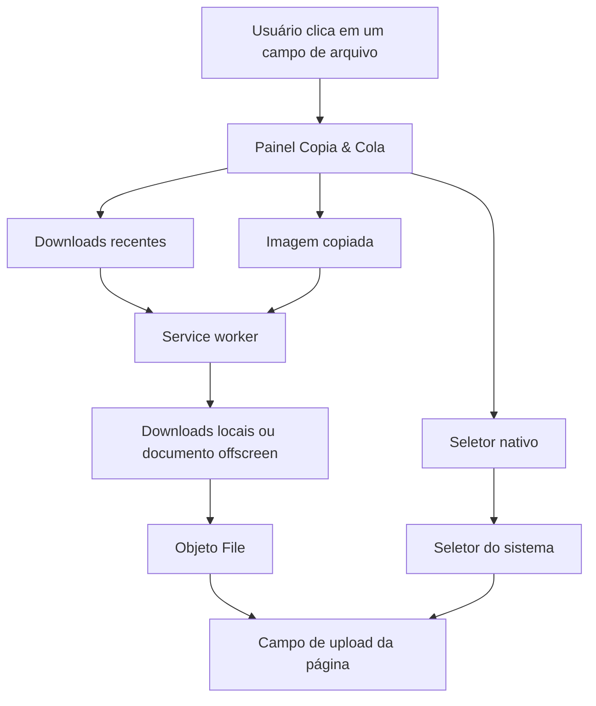

<div align="center">

# 📎 Copia & Cola

**O arquivo certo, na hora de anexar.**

Uma extensão para Google Chrome que reúne **imagens copiadas** e **downloads recentes** em um painel rápido, diretamente no campo de upload dos sites.

<p>
  
  
  
  
  
</p>

[**Instalar**](#-instalação) · [**Como usar**](#-como-usar) · [**Privacidade**](#-privacidade-e-permissões) · [**Desenvolvimento**](#-desenvolvimento)

</div>

---

## ✨ Uma forma mais simples de anexar

Já copiou um print ou baixou uma imagem e precisou abrir o Explorador de Arquivos para encontrá-la? O **Copia & Cola** reduz esse caminho: ao interagir com um campo de arquivo compatível, você encontra seus anexos mais recentes sem sair da página.

| Recursos | O que fazem |
| --- | --- |
| 📋 **Imagens copiadas** | Exibe uma imagem da área de transferência, quando o Chrome autoriza a leitura; oferece `Ctrl+V` como alternativa. |
| ⬇️ **Downloads recentes** | Lista os últimos arquivos baixados pelo Chrome, com nome, tamanho, data e miniaturas quando disponíveis. |
| 🔎 **Busca instantânea** | Filtra os downloads exibidos pelo nome do arquivo. |
| 🖼️ **Pré-visualização** | Destaca imagens com miniaturas para facilitar a escolha. |
| ✅ **Seleção múltipla** | Permite selecionar vários anexos se o campo de upload aceitar múltiplos arquivos. |
| 🗂️ **Seletor original** | Mantém o botão **Escolher do computador** para abrir o seletor padrão. |
| 🎨 **Tema adaptativo** | Interface em modo claro ou escuro, de acordo com o navegador/sistema. |
| ⚙️ **Preferências** | Ajusta a quantidade de downloads, limite de tamanho, clipboard e sites ignorados. |

> **Tudo acontece no navegador.** A extensão não precisa de conta, servidor próprio ou serviço externo para funcionar.

## 🚀 Instalação

A extensão ainda está em desenvolvimento e é distribuída pelo próprio repositório, **não pela Chrome Web Store**.

### Opção 1 — Clonar o repositório

```bash
git clone https://github.com/bielcerroni/copia-e-cola.git
```

### Opção 2 — Baixar os arquivos

Acesse **[o repositório no GitHub](https://github.com/bielcerroni/copia-e-cola)**, clique em **Code → Download ZIP** e extraia o conteúdo.

### Ativar no Chrome

1. Abra `chrome://extensions`.
2. Ative **Modo do desenvolvedor** (canto superior direito).
3. Clique em **Carregar sem compactação**.
4. Selecione a pasta que contém o arquivo `manifest.json`.
5. Atualize as páginas que já estavam abertas e teste um campo de anexo.

**Para usar downloads locais:** abra **Detalhes** da extensão em `chrome://extensions` e habilite **Permitir acesso a URLs de arquivo**. Sem essa autorização, o histórico poderá ser exibido, mas o conteúdo dos downloads não poderá ser anexado pelo painel.

## 🧭 Como usar

**Anexar uma imagem copiada**

1. Copie uma imagem ou faça uma captura de tela.
2. Clique no botão de anexo de um site compatível.
3. Escolha a imagem na seção **Área de transferência**.
4. Se ela não aparecer automaticamente, dê foco ao painel e pressione `Ctrl+V`.

**Anexar um arquivo baixado**

1. Baixe o arquivo normalmente pelo Chrome.
2. Abra o campo de upload do site.
3. Encontre o arquivo em **Downloads recentes**; use a busca, se necessário.
4. Clique para anexar. Se o campo permitir múltiplos arquivos, selecione os desejados e confirme.

O painel também oferece **Escolher do computador** para continuar usando o seletor do sistema operacional. Pressione `Esc` para fechar o painel.

## ⚙️ Personalização

Abra **Preferências** no rodapé do painel ou em **Detalhes → Opções da extensão** no Chrome.

| Configuração | Valor inicial | Possibilidades |
| --- | --- | --- |
| Downloads exibidos | `8` | De 1 a 20 arquivos recentes. |
| Tamanho máximo por arquivo | `12 MB` | De 1 a 40 MB para leitura de downloads pelo painel. |
| Mostrar área de transferência | Ativado | Exibir ou ocultar a seção de imagens copiadas. |
| Sites ignorados | Nenhum | Inserir domínios, um por linha; subdomínios também são ignorados. |

O limite configurado para downloads evita carregar arquivos grandes pela comunicação interna da extensão. Para arquivos maiores, utilize **Escolher do computador**.

## 🔐 Privacidade e permissões

O **Copia & Cola** foi criado para facilitar a escolha de arquivos, não para monitorar navegação ou guardar uma biblioteca pessoal.

- **Sem conta e sem backend:** não há cadastro, API externa da extensão ou telemetria implementada.
- **Clipboard sob demanda:** a leitura da imagem copiada é solicitada quando você abre o painel. Não há monitoramento contínuo nem histórico persistente do clipboard.
- **Arquivos sob demanda:** o conteúdo dos downloads é lido para miniaturas elegíveis ou quando você escolhe anexá-los. A extensão não percorre indiscriminadamente todas as pastas do computador.
- **Preferências locais:** as configurações ficam em `chrome.storage.local`.
- **Upload continua sendo do site:** ao selecionar um arquivo, ele é entregue ao campo de anexo da página. **O site de destino poderá receber o arquivo se o upload for enviado**, como ocorreria no seletor tradicional.

### Por que o Chrome solicita estas permissões?

| Permissão | Finalidade |
| --- | --- |
| `downloads` | Consultar o histórico recente de arquivos baixados pelo Chrome e obter metadados. |
| `clipboardRead` | Permitir a tentativa de leitura de uma imagem copiada. |
| `offscreen` | Realizar a leitura sob demanda no contexto da extensão, sem depender da política de clipboard da página. |
| `storage` | Salvar preferências localmente. |
| `file:///*` | Solicitar acesso ao conteúdo de downloads locais, **somente após a autorização nas configurações do Chrome**. |
| Scripts em páginas HTTP/HTTPS | Identificar campos de arquivo e apresentar o painel junto ao campo de upload. |

O código é aberto para inspeção neste repositório.

## 💬 WhatsApp Web e outras extensões

A versão `0.1.2` separa a leitura do clipboard do contexto da página para evitar erros de **Permissions Policy**, como os que podem ocorrer no WhatsApp Web. O `Ctrl+V` só é capturado pelo Copia & Cola quando o foco está em seu próprio painel; colar uma imagem diretamente na conversa continua sendo uma ação do WhatsApp.

O painel usa **Shadow DOM** para isolar sua apresentação e foi ajustado para **respeitar o escudo ativo da extensão de privacidade Neblina**, sem desativar suas proteções.

**Importante:** os sites podem implementar uploads de maneiras diferentes, e atualizações de interface podem afetar a integração. Esses cuidados de compatibilidade não representam garantia de funcionamento em todos os formulários do WhatsApp Web, Gmail ou outras aplicações.

## 🩹 Solução de problemas

<details>
<summary><strong>A imagem copiada não aparece no painel</strong></summary>

A leitura automática pode ser limitada pelo foco ou pelas permissões do navegador, mesmo no documento interno da extensão. Clique dentro do painel e pressione **Ctrl+V**. Verifique também se **Mostrar imagens da área de transferência** está ativado nas preferências.

</details>

<details>
<summary><strong>Vejo os downloads, mas não consigo anexá-los</strong></summary>

Abra `chrome://extensions`, entre em **Detalhes** do Copia & Cola e habilite **Permitir acesso a URLs de arquivo**. Confirme que o arquivo ainda existe no local onde foi baixado. Para um arquivo acima do limite configurado, use **Escolher do computador**.

</details>

<details>
<summary><strong>O painel não abre em um site</strong></summary>

Atualize a aba após instalar ou recarregar a extensão. Confira se o domínio não está na lista de sites ignorados. A extensão atua sobre campos HTML de arquivo; alguns serviços usam fluxos próprios que ainda podem exigir ajustes específicos.

</details>

<details>
<summary><strong>Quero colar normalmente em uma conversa</strong></summary>

Deixe o foco no editor da conversa, não no painel Copia & Cola. A extensão não deve interceptar o `Ctrl+V` direcionado ao editor da página. Se houver comportamento inesperado, registre o site, a versão do Chrome e o passo a passo em uma issue.

</details>

## 🛠️ Desenvolvimento

**Tecnologias:** JavaScript, HTML, CSS e **Chrome Extensions Manifest V3**. Não é necessário bundler ou servidor para instalar a extensão localmente.

```text
copia-e-cola/
├── manifest.json         # Definição da extensão e permissões
├── content.js            # Painel e integração com campos de upload
├── background.js         # Service worker e consulta aos downloads
├── offscreen.html        # Documento auxiliar de clipboard
├── offscreen.js          # Leitura de imagens copiadas sob demanda
├── shared.js             # Utilitários compartilhados
├── options.html          # Interface de preferências
├── options.js            # Persistência das preferências
├── tests/                # Testes unitários e smoke tests
└── LICENSE               # MIT
```

### Executar os testes

**Testes unitários** — requer Node.js:

```bash
npm test
```

**Smoke tests** — requer Python, Playwright e um Chromium disponível no ambiente de testes:

```bash
python tests/browser_smoke.py
python tests/compatibility_smoke.py
python tests/offscreen_smoke.py
```

Os smoke tests usam simulações das APIs da extensão; os scripts atuais estão preparados para o Chromium em `/usr/bin/chromium`. Eles **não substituem** uma homologação com a extensão instalada no navegador real.

### Como funciona, por dentro



## 🗺️ Próximos passos

- [ ] Homologar a extensão instalada em versões atuais do Chrome, inclusive WhatsApp Web e Gmail.
- [ ] Ampliar suporte a formulários com mecanismos personalizados de upload e drag-and-drop.
- [ ] Melhorar a cobertura de testes de integração e acessibilidade.
- [ ] Avaliar atalhos e ações rápidas adicionais.
- [ ] Preparar o projeto para uma possível publicação na Chrome Web Store.

Sugestões e relatos de defeitos são bem-vindos em **[Issues](https://github.com/bielcerroni/copia-e-cola/issues)**. Ao relatar um problema, informe a versão da extensão, do Chrome, o site e como reproduzir; evite anexar arquivos ou capturas com dados pessoais.

---

<div align="center">

**Copia & Cola** · Feito para deixar o upload mais rápido, sem complicar o que já funciona.

Desenvolvido por [**bielcerroni**](https://github.com/bielcerroni) · Licenciado sob [**MIT**](LICENSE)

</div>